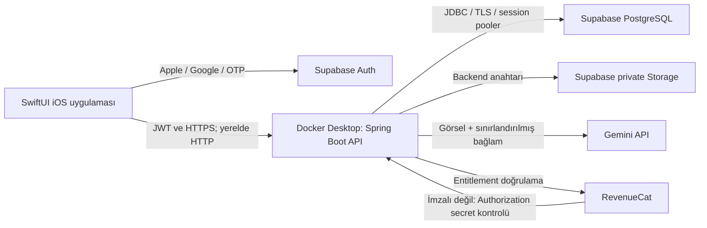

# Spark backend ve servis planı

Tarih: 7 Kasım 2026. Kaynaklar: `files/spark_codex_prompts_ios.md`, `design_files/` HTML çıktıları ve ekran/akış belgesi.

## 1. Kararlaştırılan mimari

Backend Java 21, Spring Boot 3.x, Maven ile yazılacak ve Docker Desktop üzerinde çalışacak. Vercel kullanılmayacak. Docker Desktop yerel geliştirme ortamıdır; bilgisayar kapalıyken hizmet vermez ve tek başına internet üzerinden erişilebilir bir production ortamı sağlamaz.

İlk sürüm tek uygulama içinde modüllerden oluşacak. Ayrı mikroservis, Redis, Kafka, Kubernetes, özel OCR sunucusu ve Supabase Edge Function başlangıç için gerekli değil. Supabase yönetilen servisleri uzakta, Java uygulaması yerelde çalışacak. Bulut bağlantısı olmadan iskeleti doğrulamak için Docker Compose içinde ayrı bir geliştirme PostgreSQL'i kullanılacak; bu servis Supabase Auth/Storage yerine geçmez.

## 2. Kurulacak altyapı

| Bileşen | Görev | Başlangıç ayarı / bağımlılık |
| --- | --- | --- |
| Docker Desktop + Compose | Backend container'ı ve yerel geliştirme DB'si | Java 21 runtime, Maven build, kalıcı DB volume, healthcheck |
| Spring Boot API | `/v1` iş kuralları ve REST API | `com.spark.api`, Web, Security Resource Server, JPA, Validation, Flyway, Actuator, springdoc |
| Supabase PostgreSQL | Uygulama verileri | Önerilen proje adı `spark-dev`; bölge önerisi Frankfurt, hesapta uygunluğu doğrulanacak |
| Supabase Auth | Apple, Google, email OTP | JWKS doğrulama; Apple/Google sağlayıcı kimlikleri ayrıca gerekli |
| Supabase Storage | İzin verilirse görsellerin saklanması | Private `inputs` bucket, kullanıcı/üretim bazlı anahtar, kısa ömürlü signed URL |
| Gemini | Opener, reply, stil analizi | API anahtarı yalnız backend'de, model config üzerinden ve uygulama fazında doğrulanacak |
| RevenueCat | App Store abonelikleri | `plus` entitlement, app user id = Supabase user id, webhook secret, sunucudan doğrulama |
| Email SMTP | Production OTP teslimatı | Geliştirmede hesap sınırları kontrol edilecek; yayın öncesi SMTP sağlayıcısı ve domain doğrulaması |
| CI | Derleme / doğrulama | Repo remote'u bağlandıktan sonra Maven verify + Testcontainers + Docker build |
| Temizlik görevi | Artık görsellerin silinmesi | Spring zamanlanmış görev, 24 saati aşmış sahipsiz objeler; çoklu instance için DB kilidi |

Ücretli plan, ek hizmet veya abonelik otomatik açılmayacak; mevcut hesap/kota ve proje maliyeti oluşturma ekranında doğrulanacak. TestFlight / production öncesi development ve production Supabase projeleri ayrılacak. İkinci projenin açılması mevcut kota ve maliyetle birlikte ele alınacak.

## 3. Spring Boot modülleri

| Modül | Servis sorumlulukları | Endpoint grupları |
| --- | --- | --- |
| `identity` / `profile` | JWT subject, ilk istekte profile upsert, yaş/AI onayı, timezone, tercihler | `GET/PATCH/DELETE /v1/me` |
| `usage` / `plans` | Free 3/gün, Plus 100/gün, özellik ve kişi/klasör sınırları | `GET /v1/me/usage` |
| `generation` | Idempotency, kota rezervasyonu, opener 5 / reply 4 öneri, thread bağlantısı | `POST /v1/generations/opener`, `/reply`, `GET /v1/generations`, `/{id}` |
| `ai` | Gemini HTTP adaptörü, prompt versiyonlama, şema doğrulama, 25s timeout, 5xx için tek retry | İç servis; istemciye ham model hatası dönmez |
| `contacts` | Kullanıcıya ait kişiler, durum, ilgi ve notlar | `/v1/contacts` |
| `history` | Thread timeline, Free için 7 günlük görünürlük, geçmiş silme | `/v1/threads` |
| `saved` | Favoriler, template ve klasörler | `/v1/saved`, `/v1/folders` |
| `tones` | 7 yerleşik ton, Plus özel ton CRUD | `/v1/tones` |
| `style` | 5–10 örnek mesaj, JSON stil özeti, aç/kapat ve silme | `/v1/style-profile` |
| `feedback` | Beğeni, gönderildi/yanıtlandı, AI sonuçlarını raporlama | `/v1/suggestions/{id}`, `/{id}/report` |
| `billing` | RevenueCat webhook deduplication, entitlement yenileme ve süre sonu | `/v1/billing/webhook`, `/sync` |
| `privacy` / `storage` | Görsel yaşam döngüsü, hesap/veri/obje silme, yetim obje temizliği | İç servis ve `/v1/me` silme akışı |
| `platform` | Request ID, ortak hata modeli, loglama, sağlık ve rate limiting | `/actuator/health` |

Her modül controller → service → repository düzeninde olacak; DTO ve entity ayrılacak. Auth dışındaki uygulama verilerine iOS doğrudan Supabase Data API üzerinden erişmeyecek. Her sorgu ve bağlı kayıt ataması kullanıcı sahipliğini doğrulayacak.

## 4. Veritabanı planı

Flyway tek şema değişikliği otoritesi olacak; Hibernate `ddl-auto=validate`. Supabase CLI migration sistemiyle aynı şema paralel yönetilmeyecek. Ürün şeması prompttaki `V1__init.sql`, yerleşik tonlar `V2__seed_tones.sql` ile foundation fazında eklenecek.

Temel tablolar: `profiles`, `tones`, `contacts`, `threads`, `generations`, `suggestions`, `folders`, `saved_items`, `style_profiles`, `reports`. UUID kimlikler, UTC `timestamptz`, text + CHECK kısıtları kullanılacak. Prompttaki alanlar, FK ve indeksler esas alınacak.

- `profiles.id` → `auth.users.id`. Yerel saf PostgreSQL testi bu ilişki için yalnız test ortamına ait auth fixture gerektirir; production'da Supabase'in auth şeması uygulama tarafından yaratılmaz/değiştirilmez.
- Tüm tablolarda RLS açık; `anon` ve `authenticated` için uygulama tablolarına erişim politikası yok. Backend sahiplik kontrollerini uygular. Runtime DB rolünün bu erişim modeline uygun ayrıcalıkları foundation fazında açıkça tanımlanır; mobil istemciye DB bilgisi verilmez.
- Supabase'de public şeması Data API üzerinden açılabildiğinden RLS ve rol grant'leri sorguyla doğrulanacak; işlevsel olmayan yetkiler kapalı kalacak.
- `(user_id, created_at desc)` indeksleri, thread son etkinlik indeksi, saved folder indeksi ve FK sorgularına gereken indeksler eklenir.
- Farklı kullanıcının `contactId`, `toneId`, `threadId`, `folderId`, `suggestionId` değerlerini bağlama denemeleri engellenir; gereken yerlerde bileşik kısıt kullanılır.
- DB bağlantısı uzun ömürlü Java servisi için session pooler (5432), TLS ve küçük Hikari havuzu ile başlar. Host/username panelden alınır, tahmin edilmez. Transaction pooler gerekirse `prepareThreshold=0`; migration bağlantısı session/direct olur.
- RevenueCat olay tekrarlarını ve sıra dışı teslimatı yönetmek için ayrı webhook event kayıt tablosu foundation sonrasındaki billing migration'ında eklenir.

## 5. Kritik iş kuralları

1. Yaş ve üçüncü taraf AI onayı yoksa üretim başlamaz. JWT issuer/audience/imza/süre doğrulanır; yeni projede asimetrik JWKS tercih edilir.
2. Kota kullanıcının IANA timezone'unda yerel gün başlangıcına göre hesaplanır. Kalıcı bakiye alanı yok; yalnız SUCCEEDED üretimler kredi tüketir. DST günleri ve timezone değiştirerek kota aşma senaryoları test edilir.
3. Eşzamanlı isteklerde `count < limit` kontrolü tek başına yeterli değildir. Kısa DB transaction'ında kullanıcı bazlı kilit ve PENDING rezervasyonlarıyla kapasite ayrılır; AI çağrısı sırasında DB transaction'ı açık tutulmaz. Kullanıcıya gösterilen tüketim SUCCEEDED üzerinden hesaplanır. Süresi dolan PENDING rezervasyonları güvenli şekilde temizlenir.
4. `(user_id, idempotency_key)` unique. Aynı anahtar + aynı içerik başarılıysa kayıtlı sonuç döner; farklı içerikte 409, devam eden istekte belgelenmiş 409 davranışı kullanılır. İstek fingerprint alanı migration ile eklenir. Retry yeni kredi tüketmez.
5. Opener tam 5, reply tam 4 farklı öneri; her biri en fazla 220 karakter. BLOCKED/FAILED kredi tüketmez. Başarılı kayıt ve öneriler atomik kaydedilir.
6. Free: 3 kişi, 3 klasör, yalnız built-in tonlar, 7 günlük geçmiş görünürlüğü. Plus: 100 üretim/gün, Continue Chat, My Style, custom tones ve templates. Geçmiş görünürlüğü ile fiziksel silme ayrı politikalardır; 7 gün dolunca otomatik veri silindiği iddia edilmez.
7. İstemciden gelen plan bilgisine güvenilmez; RevenueCat backend'den kontrol edilir. Cancellation tek başına anında Free yapmaz, entitlement bitişi esas alınır. Webhook tekrarı ve geç gelen event test edilir.
8. Görseller varsayılan olarak bellekte işlenir; kalıcı saklama yalnız açık tercih varsa. Private bucket içinde `{userId}/{generationId}/...` anahtarı kullanılır (`inputs` bucket adı path'e ikinci kez eklenmez). Gereksiz objeler hata/retry durumunda da temizlenir.
9. Hesap silme DB, Storage ve Auth arasında yeniden denenebilir bir iş akışıdır. Önce hesap erişimi kapatılır ve session'lar iptal edilir, objeler kaldırılır, Auth kullanıcısı silinir ve ilişkili kayıtların kaldırılması doğrulanır. Silinen kullanıcının henüz süresi dolmamış JWT'si yeni profile oluşturamaz.
10. Hatalar `{code, message, requestId}` biçiminde; prompttaki HTTP kodları korunur. Yeni conflict/onay hata kodları OpenAPI'ye açıkça eklenir. Görsel, token, kişisel not ve mesaj metni loglanmaz.

## 6. Tasarım ile prompt arasındaki farklar

| Referans | Fark | Uygulama kararı |
| --- | --- | --- |
| `c3_add_person`, `f1_profile_settings` | On-device / üçüncü tarafla sıfır veri paylaşımı ifadesi | Gemini'ye görsel/not aktarımı açıkça anlatılır; yalnız yerel OCR opsiyonu ileride ayrı değerlendirilir |
| `b1_home`, `f1_profile_settings` | Unlimited generation | Plus adil kullanım limiti 100/gün olarak gösterilir |
| `b2_match_detail`, Saved ve özet belge | Match yüzdesi / yanıt oranı | Gerçek ölçüm olmadan bu sayılar kullanılmaz; yanıt olasılığı tahmini eklenmez |
| B2/C3 hook extraction | Prompt API'sinde ayrı OCR/hook endpoint'i yok | İlk sürümde kişi ilgi alanları elle girilir. Otomatik extraction sonraki ayrı özellik/faz; ayrı API sözleşmesi ve maliyet/kota kararı gerekir |
| Home momentum / strateji / randevu taktikleri | Prompt gamification ve date coaching'i kapsam dışında bırakıyor | Bu özellikler backend kapsamına alınmaz |
| Ekran kodları | Tasarım D1 Saved / E1 History / F1 Profile; prompt D History / E Saved / F Tones / H Profile | Uygulama modül adları esas alınır; ekran referansında dosya adı da yazılır |
| Kayıtlı iOS proje | Mevcut proje `MyCoach/`, prompt `/ios/Spark` diyor | Bu işte iOS taşınmaz; backend kökte `/backend` altında açılır |

## 7. Geliştirme fazları ve kabul koşulları

| Sıra | Çıktı | Doğrulama |
| --- | --- | --- |
| 0 — İskelet | Maven/Java21, Dockerfile, Compose, env örneği, ortak hata/request ID, health, API docs | Maven verify; Docker image build; health 200; auth'suz `/v1` 401 |
| 1 — Foundation | Supabase proje bağlantısı; Flyway şema/seed; JWT; profile/usage/tones/plan | Temiz DB migration; JWT issuer/audience; timezone/DST; kullanıcı izolasyonu |
| 2 — Opener | Gemini adaptörü, prompt, idempotency/kota rezervasyonu, görsel güvenliği | Mock Gemini entegrasyon; eşzamanlı kota; başarısız üretimde kredi yok; gerçek deneme |
| 3 — Bellek | Contacts, timeline, Saved, folders, feedback/report | Kullanıcı A'nın B verisine tüm yollardan erişememesi ve Free sınırları |
| 4 — Abonelik | RevenueCat webhook/sync | Sandbox purchase/restore/expiry, replay ve sırasız event |
| 5 — Reply | Plus, text/1–3 image, 4 öneri | Dosya tür/boyut doğrulama, plan kontrolü, Gemini mock |
| 6 — Stil | My Style, özel tonlar | Örnek sayısı/boyutu, prompt sınırları, silme |
| 7 — Gizlilik | Hesap/geçmiş silme, orphan cleanup | DB + Storage + Auth silme doğrulaması, eski JWT reddi |
| 8 — Yayına hazırlık | CI, OpenAPI snapshot, gerçek cihaz ağ/HTTPS, secret ve performans doğrulaması | Uçtan uca iOS, production barındırma ve webhook erişimi |

Bir faz doğrulanmadan sonraki faz tamamlanmış sayılmaz. Kullanıcının sonraki talebiyle backend kapsamı bütün yerel modüllere genişletildi. Yerel doğrulama kanıtları `docs/backend/verification.md` dosyasında izlenir; iOS geliştirmesi ve gerçek bulut hesaplarının yayın doğrulaması bu yerel backend görevinden ayrıdır.

## 8. Docker Desktop erişimi

Başlangıçta API yalnız `127.0.0.1:8080` adresine açılır. iOS Simulator aynı Mac üzerinde `http://localhost:8080` kullanabilir; geliştirme HTTP izni yalnız Debug config'e eklenir. Gerçek iPhone için LAN IP bind/firewall ve aynı Wi-Fi veya HTTPS geliştirme tüneli ayrıca gerekir. Release config HTTPS kullanır.

RevenueCat sunucuları localhost'a webhook gönderemez. Yerel testte CLI/sandbox payload ile doğrulama veya geçici HTTPS tüneli gerekir; kalıcı production webhook için erişilebilir sunucu şarttır. Bu aşamada tünel ya da public port açılmaz.

## 9. Kaynaklar

- [Supabase + Spring Boot](https://supabase.com/docs/guides/getting-started/quickstarts/spring-boot)
- [DB bağlantı yöntemleri](https://supabase.com/docs/guides/database/connecting-to-postgres)
- [JWT signing keys](https://supabase.com/docs/guides/auth/signing-keys)
- [Private storage](https://supabase.com/docs/guides/storage/buckets/fundamentals)
- [Supabase değişiklik günlüğü](https://supabase.com/changelog)

Kontrol: 7 Kasım 2026. CLI v3 davranışı değişmiş olduğundan Supabase CLI kullanılacaksa önce sürüm ve `--help` çıktısı kontrol edilir. PostgreSQL timezone düzeltmeleri kota testlerinde dikkate alınır. Java/iOS stack'i Flutter/JS adapter breaking change'lerinden etkilenmez.
